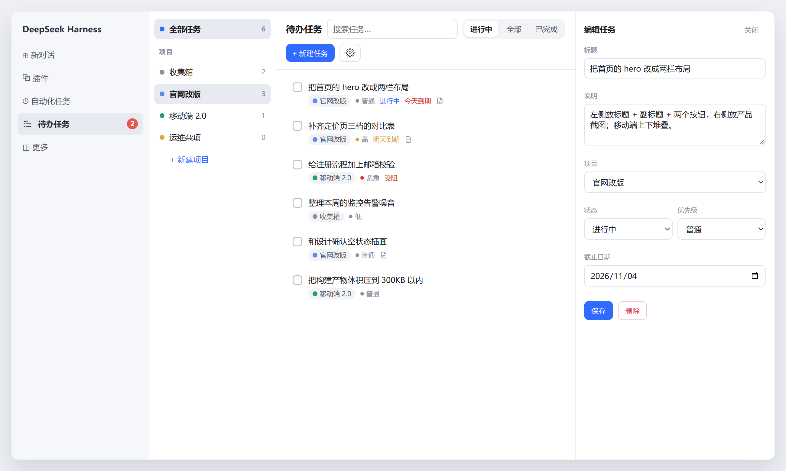
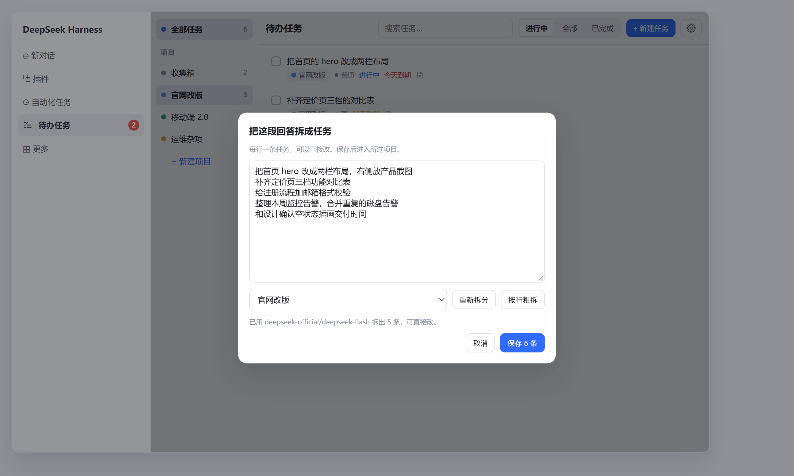
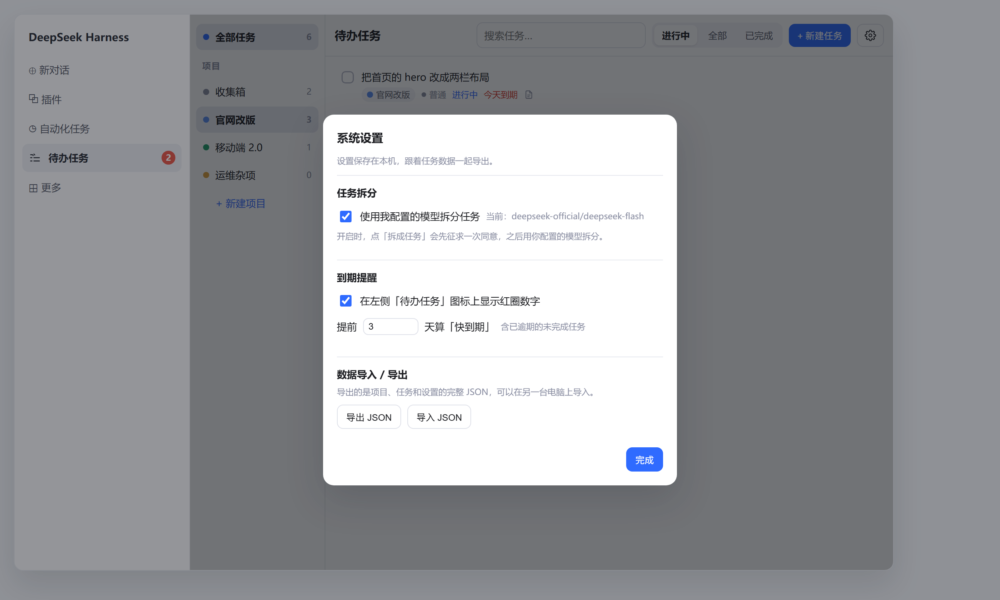
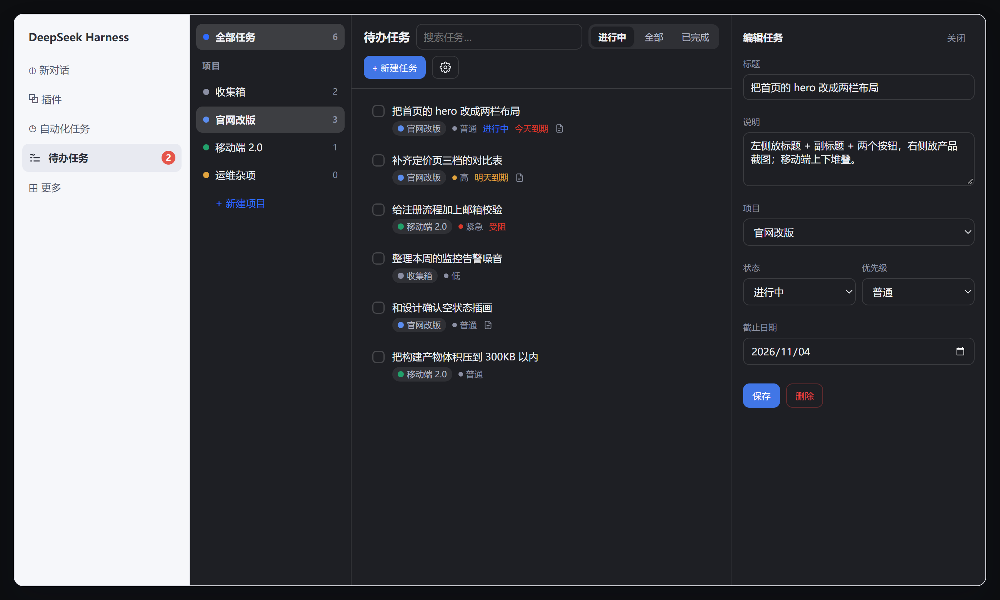
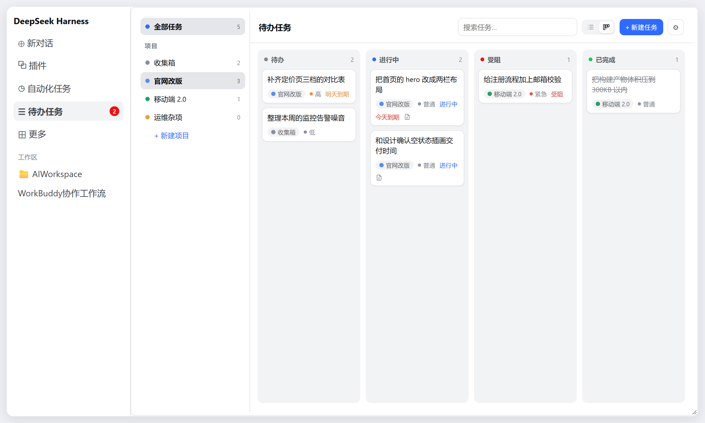

<div align="center">

# Todo · dsh-gor-tasks

**Put "things to do" inside DeepSeek Harness: a sidebar entry, project buckets, task edits from chat, and one click to turn an answer into tasks.**


[中文](README.md) · **English**

</div>

---

## What it solves

Chats are lively, but the actual work ends up scattered across messages. This plugin adds a **structured** task entry point to DSH:

- a "Todo" row in the left sidebar opens a full task manager;
- every task belongs to a **project**; Inbox is the default one, and projects can be renamed, deleted and reordered by drag;
- without leaving the conversation you can ask the assistant to create tasks, change status, list what is left;
- when an answer is done, hit "拆成任务 / Split into tasks" and turn it into a few todos filed under a project.

---

## What it looks like

**Task panel** — projects on the left, tasks in the middle, an edit drawer on the right. The red number at the end of the sidebar row is how many are due soon.



**Split an answer into tasks** — on any assistant reply, click "Split into tasks" in the action row; your own configured model does the splitting, and you can edit the drafts.



**Settings** — model split toggle, due reminders, data import/export.



**Dark mode** — every colour comes from DSH theme variables, so it follows the host light/dark setting automatically.



**Board view** — flip the view switch in the toolbar; the four columns are the four statuses, and cards can be dragged between them to change status.



---

## Features

| Capability | Detail |
| --- | --- |
| Sidebar entry | A "Todo" row; the red badge counts unfinished tasks that are due soon |
| Three-column UI | Project list / task list / edit drawer, collapses automatically on narrow windows |
| Projects | Create, rename, recolor, delete; deletion tells you how many tasks go with it |
| Drag to reorder | Project order is display order, Inbox included |
| Task fields | Title, notes, status (todo / doing / blocked / done), priority, due date |
| Filtering | All tasks or one project; doing / all / done; keyword search |
| Smart lists | Due today / next 7 days / overdue / high priority / no due date, one click from the sidebar with live counts |
| Batch actions | Tick tasks (Shift to range-select, select all), then change status, move project or delete in one go |
| Undo | Deleting a task, a project or a batch gives an 8-second undo that also restores task order |
| Custom order | Switch the list view to "custom" and drag task rows; the choice is remembered |
| Two views | List view with status tabs; board view with one column per status — drag cards between columns, the choice is remembered |
| Manage from chat | 10 tools: list/create/update/delete projects and tasks, bulk add and bulk update |
| Split an answer | "Split into tasks" in the message action row, using your own model or a no-model line split |
| Settings | Model split toggle, due reminder toggle and lead days, data import/export |
| Light/dark | All colours come from DSH theme variables; follows the host theme (including "follow system") |
| Portable data | Export projects + tasks + settings as JSON, import on another machine |

---

## Install

**Plugin marketplace**: once published, search "Todo" in the DSH plugin marketplace and install with one click — no config files involved.

**Development**: clone the repo and link it into your profile; refresh the page after edits, no reinstall needed.

```bash
git clone git@github.com:gorwayne/dsh-gor-tasks.git
```

Dev-time mounting (for reference only; production installs go through the marketplace):

`cordis.patch.yml`:

```yaml
- insert:
    - id: dsh-gor-tasks
      name: "@local/dsh-gor-tasks"
```

Profile `package.json` (point the path at your clone):

```json
{
  "dependencies": { "@local/dsh-gor-tasks": "link:/path/to/dsh-gor-tasks" }
}
```

> After changing the Host side (`index.js`), disable and re-enable the plugin or restart DSH; changing only `client.js` needs just a page refresh.

---

## Usage

### 1. The UI

- Click "Todo" in the sidebar to open three columns: projects on the left, tasks in the middle; clicking a task slides out the editor on the right.
- Besides "All tasks" and your projects, the sidebar has **smart lists**: due today, next 7 days, overdue, high priority, no due date;
- "+ New task": title required, project / status / priority / due date optional;
- hovering a project row reveals `✎` (rename), `✕` (delete) and `⋮⋮` (drag);
- the small box on the left of a task row selects it (Shift for a range) and turns the toolbar into batch actions;
- the top right of the list view switches between "default" and "custom" order — in custom mode drag rows to reorder;
- the gear at the top right opens **Settings**.

### 2. Manage from chat

Just say what you want; the assistant calls the tools:

```text
Add three tasks to the "Product revamp" project: collect competitor screenshots, write the release notes, book a design review. The last one is due Friday.
Mark "write the release notes" as doing.
List what's still open in that project.
```

Tools:

| Tool | Purpose |
| --- | --- |
| `project_list` / `project_create` / `project_update` / `project_delete` | list, create, update, delete projects |
| `task_list` / `task_create` / `task_update` / `task_delete` | list, create, update, delete tasks |
| `task_bulk_add` | add several at once (this is what the split dialog uses) |
| `task_bulk_update` | change status / priority / project / due date for many tasks at once |

### 3. Split an answer into tasks

Every assistant reply has "Split into tasks" in its action row (next to copy and the thumbs).

- the first click asks once: **do you want to use your own configured model**? If you agree, it is remembered and later clicks split directly;
- if you decline, it falls back to a line/punctuation split that costs no tokens, and you can edit the drafts;
- each line becomes one task; pick a project at the bottom, and `notes` records which message it came from.

To go back to no-model splitting, open **Settings → Task split** and turn the switch off — then even the question stops appearing.

---

## Settings

Open with the gear in the top bar; every change is saved immediately.

| Setting | Default | Detail |
| --- | --- | --- |
| Use my configured model to split tasks | on | when off, "Split into tasks" only does a line split and calls no model |
| Show the red badge on the sidebar icon | on | badge = unfinished tasks that are overdue or due within N days |
| Lead days for "due soon" | 3 | 0–30; 0 means only overdue and due today |
| Export JSON | — | projects, tasks and settings in one file, timestamped |
| Import JSON | — | replaces all data; confirms first and shows the counts in the file |

---

## Data and storage

Data stays **local**, in a single JSON file:

```text
$DSH_HOME/integrations/gor-tasks/tasks.json
```

Writes use temp-file + atomic rename and are serialized; before writing it takes a `tasks.json.lock` lock and checks the file mtime, so several DSH windows no longer overwrite each other. A replacing import first backs up to `tasks.json.bak-<timestamp>` (the latest 5 are kept). Shape:

```json
{
  "version": 1,
  "projects": [{ "id": "p_inbox", "name": "Inbox", "color": "#8b8fa3", "order": 0 }],
  "tasks": [{ "id": "t_x1", "projectId": "p_inbox", "title": "Write the weekly report", "status": "todo", "priority": "normal", "due": "2026-11-08" }],
  "settings": { "useModelSplit": true, "dueReminder": true, "dueSoonDays": 3 }
}
```

Exports carry `format: "dsh-gor-tasks/export"`; import recognises that shape, and tasks pointing at a missing project fall back to Inbox.

---

## Repository layout

```text
dsh-gor-tasks/
├── package.json        # package info, dsh.bundle / dsh.client declarations
├── cordis.patch.yml    # insertion point: id + package name
├── index.js            # Host: storage, RPC, 10 tools
├── client.js           # UI: sidebar icon, task panel, split dialog, settings
├── locale/             # zh.json / en.json
├── icon.svg            # plugin icon
├── docs/images/        # screenshots used by the READMEs
├── LICENSE             # MIT
├── README.md           # Chinese
└── README.en.md        # English
```

---

## Changelog

See [CHANGELOG.md](CHANGELOG.md) (Chinese).

---

## License

[MIT](LICENSE) © 2026 gorwayne
