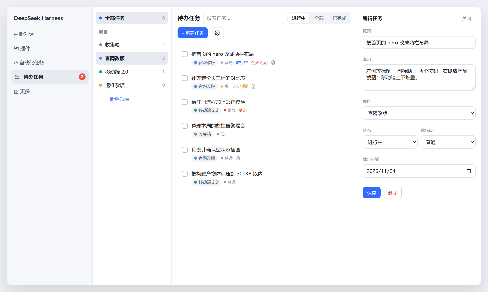
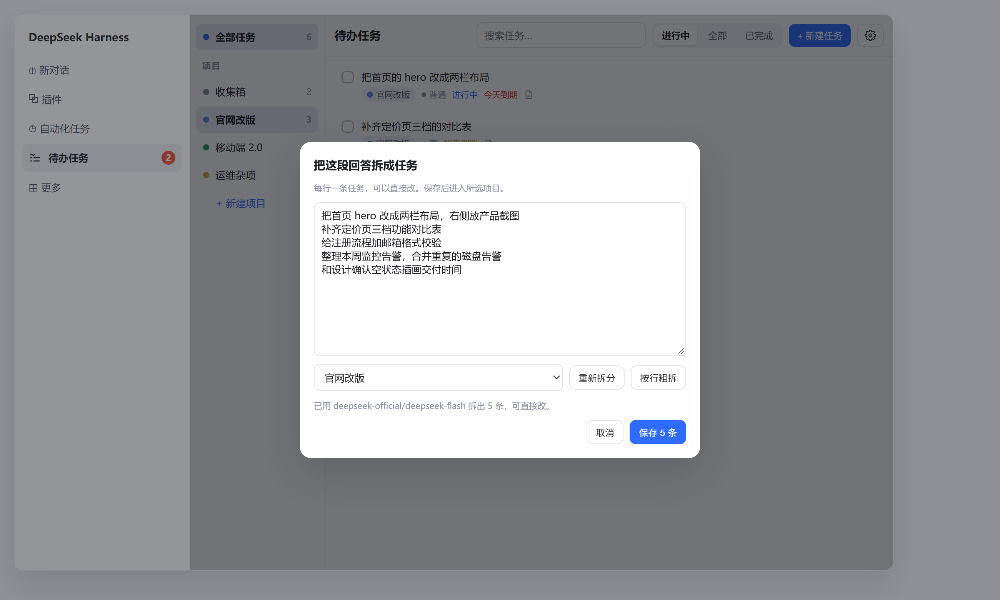
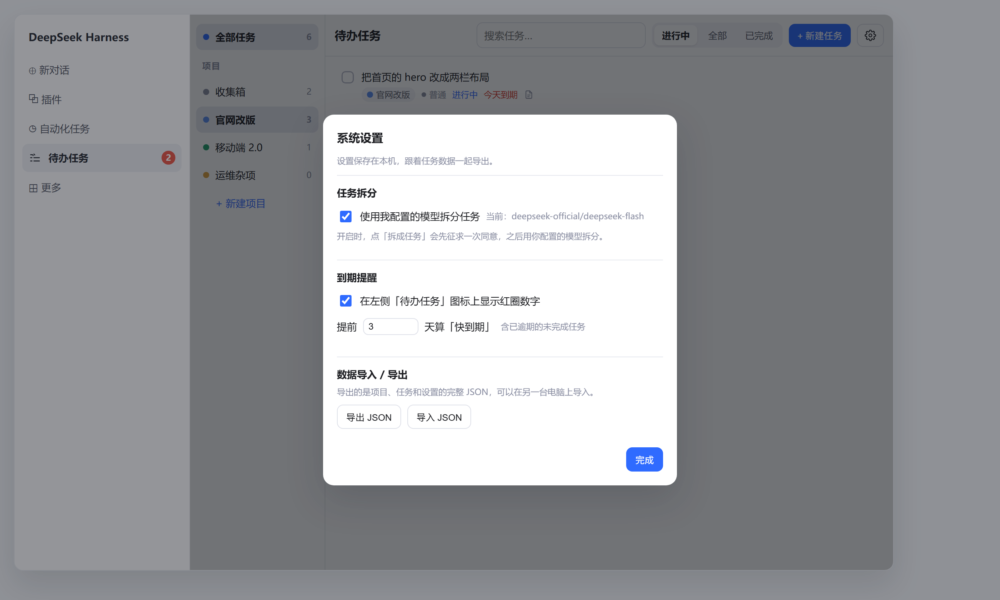
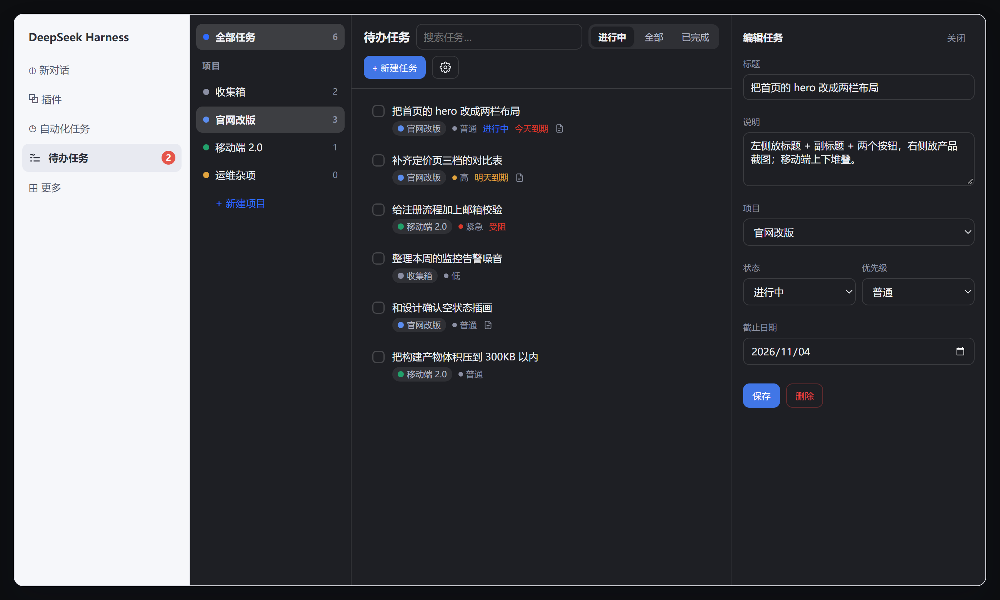

<div align="center">

# 待办任务 · dsh-gor-tasks

**把「待办」放进 DeepSeek Harness：左侧入口、项目分类、对话里增删、回答一键拆成任务。**


**中文** · [English](README.en.md)

</div>

---

## 它解决什么

DSH 里聊得很热闹，真正要动手的事却散在对话里。这个插件给 DSH 加了一个**条目化**的任务入口：

- 左侧栏多一个「待办任务」，进去就是完整的任务管理界面；
- 任务必须挂在**项目**下，收集箱是默认项目，项目可以改名、删除、拖拽排序；
- 不想切界面时，直接在对话里让助手建任务、改状态、查清单；
- 一轮回答说完，点「拆成任务」把它拆成几条待办，选个项目存进去。

---

## 长什么样

**任务面板**：左边项目、中间任务、右边编辑抽屉。侧栏「待办任务」行尾的红圈就是快到期数量。



**回答拆成任务**：任意一条助手回答，点操作条上的「拆成任务」，用你自己配置的模型拆完再改。



**系统设置**：模型拆分开关、到期提醒、数据导入导出都在这里。



**深色模式**：颜色全部走 DSH 主题变量，跟随 DSH 的明/暗设置自动切换，不用单独配。



---

## 特性

| 能力 | 说明 |
| --- | --- |
| 左侧入口 | 侧栏「待办任务」一行，行尾红色数字是快到期的未完成任务数 |
| 三栏界面 | 项目列表 / 任务列表 / 编辑抽屉，窄窗口自动折叠 |
| 项目分类 | 新建、改名、改色、删除；删除前告知会连带删掉多少个任务 |
| 拖拽排序 | 项目顺序即显示顺序，收集箱也可以拖 |
| 任务字段 | 标题、说明、状态（待办/进行中/受阻/已完成）、优先级、截止日期 |
| 过滤检索 | 全部任务 / 单项目、进行中 / 全部 / 已完成、关键字搜索 |
| 对话里管理 | 9 个工具：建项目、列项目、建任务、批量建、改任务、删任务、列任务、删项目、改项目 |
| 回答拆成任务 | 消息操作条上「拆成任务」，用你配置的模型拆分，也支持不调模型的按行粗拆 |
| 系统设置 | 模型拆分开关、到期提醒开关与提前天数、数据导入导出 |
| 明暗主题 | 配色全部取自 DSH 主题变量，跟随 DSH 的浅色/深色设置（含跟随系统）自动切换 |
| 数据可带走 | 导出 JSON（项目 + 任务 + 设置），换台电脑导入即还原 |

---

## 安装

**应用市场**：待上架后，在 DSH 的插件市场里搜「待办任务」一键安装即可，不需要动任何配置文件。

**开发态**：把仓库 clone 到本机，在 profile 里用符号链接挂上去，改代码后刷新页面生效，不用重装。

```bash
git clone git@github.com:gorwayne/dsh-gor-tasks.git
```

开发态挂载方式（仅供参考，正式安装走市场）：

`cordis.patch.yml`：

```yaml
- insert:
    - id: dsh-gor-tasks
      name: "@local/dsh-gor-tasks"
```

profile 的 `package.json`（路径换成你 clone 的位置）：

```json
{
  "dependencies": { "@local/dsh-gor-tasks": "link:/path/to/dsh-gor-tasks" }
}
```

> Host 侧（`index.js`）改完要停用再启用插件，或重启 DSH；只改 `client.js` 刷新页面就够。

---

## 用法

### 1. 界面

侧栏点「待办任务」进入三栏：左边是项目，中间是任务，点任务从右侧滑出编辑抽屉。

- 「+ 新建任务」：标题必填，可选项目、状态、优先级、截止日期；
- 项目行 hover 出现 `✎`（改名）、`✕`（删除）、`⋮⋮`（拖动）；
- 顶栏右侧齿轮是**系统设置**。

### 2. 在对话里管理

直接说人话，助手会调工具：

```text
帮我在「产品改版」项目下加三条任务：整理竞品截图、写改版说明、约设计评审，最后一条要在这周五前完成。
把「写改版说明」标成进行中。
列出这个项目还没做完的任务。
```

工具清单：

| 工具 | 作用 |
| --- | --- |
| `project_list` / `project_create` / `project_update` / `project_delete` | 项目的查、建、改、删 |
| `task_list` / `task_create` / `task_update` / `task_delete` | 任务的查、建、改、删 |
| `task_bulk_add` | 一次加多条（拆分的落库就走它） |

### 3. 把回答拆成任务

每条助手回答的操作条上都有「拆成任务」（复制、点赞那一排）。

- 第一次点会问一次：**要不要用你自己配置的模型来拆**。同意后记住，之后直接拆；
- 拒绝就按行/标点粗拆，草稿可以手改，不消耗额度；
- 拆出来的每行一条，底部选项目，保存后进对应项目，`notes` 里记来源消息。

想换回不调模型，去「系统设置 → 任务拆分」关掉开关即可——关掉后连询问都不会再出现。

---

## 系统设置

点顶栏齿轮打开，所有设置立即保存。

| 设置 | 默认 | 说明 |
| --- | --- | --- |
| 使用我配置的模型拆分任务 | 开 | 关掉后「拆成任务」只做按行粗拆，不调用任何模型 |
| 在左侧图标上显示红圈数字 | 开 | 角标数字 = 未完成且「已逾期」或「N 天内到期」的任务数 |
| 提前 N 天算「快到期」 | 3 | 0–30，0 表示只看逾期和今天到期 |
| 导出 JSON | — | 项目、任务、设置一次性导出，文件名带时间戳 |
| 导入 JSON | — | 覆盖当前全部数据，导入前二次确认并显示文件里的条数 |

---

## 数据与存储

数据在**本机**，一个 JSON 文件：

```text
$DSH_HOME/integrations/gor-tasks/tasks.json
```

写入是「临时文件 + 原子重命名」，并且串行化，避免并发写坏。格式：

```json
{
  "version": 1,
  "projects": [{ "id": "p_inbox", "name": "收集箱", "color": "#8b8fa3", "order": 0 }],
  "tasks": [{ "id": "t_x1", "projectId": "p_inbox", "title": "写周报", "status": "todo", "priority": "normal", "due": "2026-11-08" }],
  "settings": { "useModelSplit": true, "dueReminder": true, "dueSoonDays": 3 }
}
```

导出文件用 `format: "dsh-gor-tasks/export"` 标记，导入时认这个形状；缺项目引用的任务会自动归到收集箱。

---

## 目录结构

```text
dsh-gor-tasks/
├── package.json        # 包信息、dsh.bundle / dsh.client 声明
├── cordis.patch.yml    # 插入点：id + 包名
├── index.js            # Host：存储、RPC、9 个工具
├── client.js           # 界面：侧栏图标、任务面板、拆分弹窗、设置
├── locale/             # zh.json / en.json
├── icon.svg            # 插件图标
├── docs/images/        # README 用的截图
├── LICENSE             # MIT
└── README.md
```

---

## 许可

[MIT](LICENSE) © 2026 gorwayne
